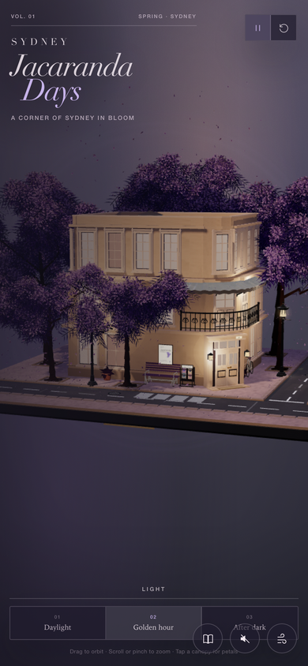
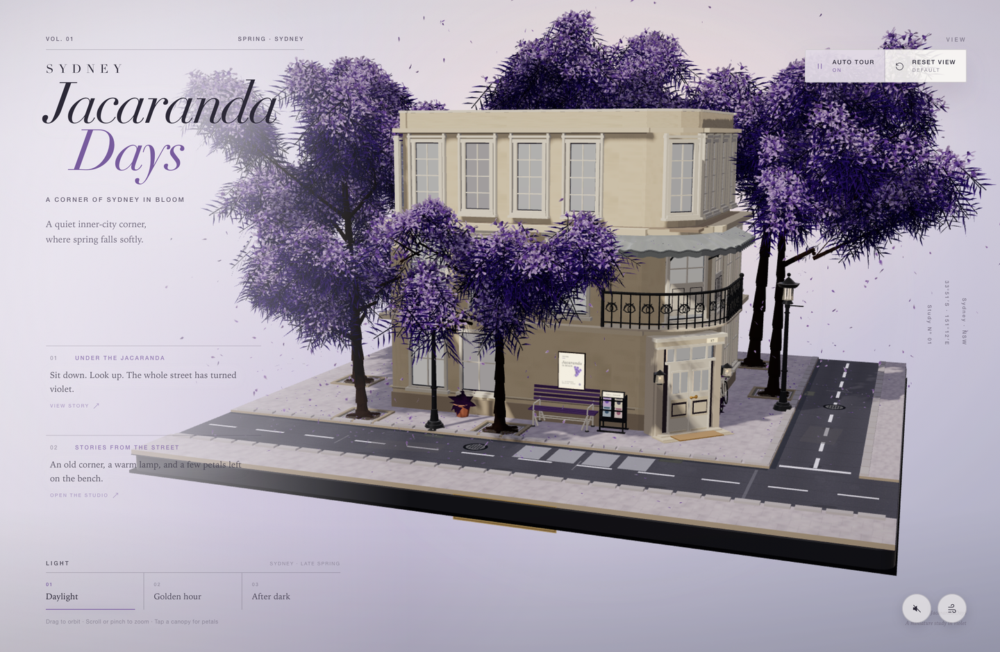
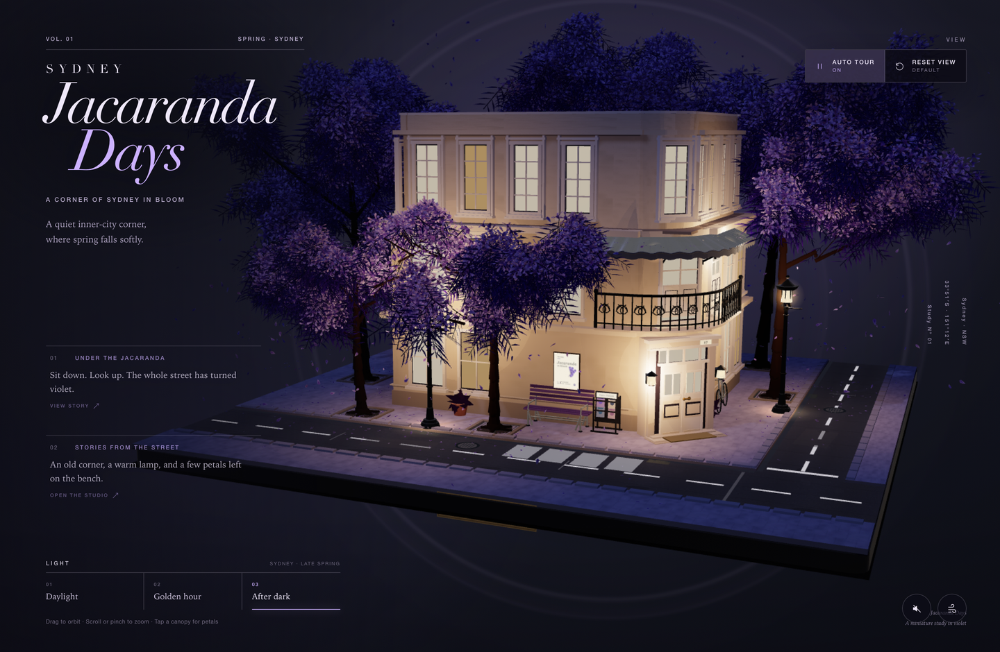

# Sydney — Jacaranda Days

一个 Three.js 制作的电影感悉尼蓝花楹街角微缩场景。奶油白的三层历史小楼被蓝紫色花冠与深紫羽状叶簇包围，树冠更密但不含绿色叶片；深色方形底座浮在暖灰紫的夜色里，窗内与路灯亮着暖光。全英文的编辑式界面、左侧标题、留白和缓慢自动漫游共同构成参考视频里的长时间镜头感，场景仍然完整支持鼠标和触屏操作。


## 运行

### 直接打开（推荐）

打开 `dist/jacaranda-corner.html`。这个文件已经把 Three.js、样式和全部源码打包进单个 HTML，可以直接双击打开，不需要服务器。

### 手机上打开

`dist/jacaranda-corner.html` 本身就是响应式移动版：竖屏会自动切到手机排版、触控按钮、三等分 Light 底栏和 1.2 DPR。

最快的方式是用同一 Wi-Fi 下的局域网服务：

```bash
cd jacaranda-corner
./serve-mobile.command
# 终端会打印 http://<你的局域网 IP>:8080/jacaranda-corner.html
```

把终端里的地址在手机 Safari / Chrome 中打开即可；点“添加到主屏幕”可全屏打开。也可以直接把 `dist/jacaranda-corner.html` 发送到手机后用浏览器打开。若本机没有 `python3`，使用任意静态文件服务器托管 `dist/` 也可以。



### 开发版本

源代码使用 ES Modules 和本地存放的 Three.js，需要通过 HTTP 服务打开：

```bash
cd jacaranda-corner
python3 -m http.server 4173
# 打开 http://127.0.0.1:4173/
```

### 重新打包单文件

```bash
cd jacaranda-corner
node scripts/build-standalone.mjs
```

构建脚本不依赖第三方打包器：它按依赖顺序拼接模块，把 Three.js 源码与场景代码分别编码为 Blob 模块，通过运行时 import map 连接，生成可直接双击打开的自包含 `dist/jacaranda-corner.html`。唯一的外部库是 Three.js r169（MIT），已放在 `vendor/three.module.min.js`。

## 操作

- 拖动：环绕观察
- 滚轮 / 双指捏合：缩放
- `Auto tour`：默认开启，镜头会缓慢呼吸式漂移；用户操作时暂停，静止约 2.4 秒后缓慢恢复，可用右上角按钮关闭
- `Reset view`：回到默认入口/阳台构图
- `Click a canopy`：触发花瓣雨
- `Light`：Daylight / Golden hour / After dark，平滑切换时段，相机位置保持不变
- 键盘：`1` / `2` / `3` 切换时段，`R` 复位

默认进入 **Golden hour**，打开自动漫游。页面采用左侧编辑式标题栏、右侧竖向坐标信息和底部 Light 时间轴，所有文字与功能键均为英文，所有操作仍可触控完成。

## Interface design

界面采用英文，并按四个基础设计原则重新组织了文字与功能键：

- **Contrast / 对比**：Didot 展示字体与字距拉开的大写小标签形成层级；Auto tour 的活动状态用紫调底色、强调色状态字和图标色，与 Reset view 的次级按钮区分。
- **Repetition / 重复**：故事段落使用 `01 / 02` 编号，Light 控件使用 `01 / 02 / 03` 编号；所有小标签共享大写、字距和 7–8px 的字号节奏，按钮共享同一套两行式结构。
- **Alignment / 对齐**：标题、故事、Light 控件全部对齐同一条左侧基线；View 工具、右侧坐标和 colophon 对齐右栏。时间选择器分成三等列，索引与名称垂直对齐。
- **Proximity / 亲近**：标题、副题与导语成组；两段街角文案成组；View 功能键成组；Light 时间轴成组。相关元素靠近，不同功能区块用留白分开。

移动端保留同一套英文层级：View 工具收成图标按钮，Light 控件变成三等分底栏，故事文案隐藏。

## 视觉实现

- **建筑**：奶油白三层小楼，前、右立面由连续圆弧连接；入口位于转角，铁艺阳台绕角，雨棚为带坡度的瓦楞金属曲面。整座建筑以 0.9 比例装入底座，附近的长椅、海报、刊物架、盆栽和自行车随之重新贴合。
- **树冠**：七棵程序化蓝花楹，各自具有不同的主干倾斜、分叉高度和树冠尺寸。树冠由约 22,900 朵紫花与约 9,760 片冷蓝紫羽状叶簇层叠组成，叶簇围绕花簇生长、沿次级枝补密，比上一版更繁茂；仍不使用任何绿色叶片，盆栽叶子也改为深紫褐色。叶簇与花朵的色相整体压向蓝紫，路灯也改用饱和度更低的暖金，因此 Golden hour 与 After dark 下不会再被暖光染成粉色。
- **底座与时间**：深炭色厚底座、冷灰铺地和深色街道形成参考视频中的底座边缘；日、黄昏、夜三套灯光共享同一组材质与灯光对象并插值切换，暖窗、路灯和入口灯在 Golden hour 与 After dark 中逐渐亮起。
- **页面**：全英文界面，`SYDNEY / Jacaranda Days` 双行标题、卷首信息、编号故事段落、带索引的 Light 时间轴、View 工具组、深色雾化边缘与轻微纸张颗粒。
- **性能**：静态网格按材质 / 阴影状态合批；枝干、花、叶、落花、树池、路缘等重复元素使用 InstancedMesh；花朵几何采用精简的 5 裂花冠与 8 边花喉。实时灯光由 11 盏减至 8 盏，材质 shader 不再随时段切换重编译；花与叶不投射逐实例阴影，改用低面数的不可见树冠阴影代理保留树冠遮挡。太阳位置固定，完整阴影贴图只在初始化时渲染一次并缓存，之后每帧不再重绘 depth pass。桌面 1440×940 稳定约 168 draw calls、1.41M 三角形（仅首帧含阴影 pass）；DPR 上限桌面 1.4、移动端 1.2。墙体新增一张 256px 程序化灰泥纹理后，资源计数为 117 geometries / 15 textures。
- **内存与帧率**：合批完成后释放不再被任何物体引用的源几何体；灯光过渡在约 2.6 秒后自动 settle，空闲帧不再写材质 / 灯光，也不每帧创建新的 `THREE.Color`；落花颜色只在粒子重生时更新；移除了会随 WebGL 画面持续重算的 `backdrop-filter` 与大面积混合模式噪点层，改用静态半透明面板和轻量 grain。

## 建筑底部闪烁修复

- **定位**：入口最低一级石阶在缩放后的顶面世界高度约为 `0.12225`，人行道顶面为 `0.12000`，间隙仅 `2.25 mm`。这个近共面关系在镜头移动、透视变化时超过深度缓冲可用精度，是底部闪动的首要来源。
- **次要来源**：建筑底部的大面积透明接触阴影平面位于路面以上约 `4.5 mm`，`depthWrite:false` 时在掠射角度会与铺地争夺深度。
- **不是主因**：阴影贴图是静态缓存，灯光位置不随相机移动；近距离查看墙面、基座未见 shadow acne。未通过关闭阴影掩盖问题，也未修改 shadow bias / resolution。
- **最小修复**：把最低一级石阶抬高约 `9 mm`（世界空间），使台阶与铺地间隙扩大到 `11.25 mm`；建筑接触阴影增加 `polygonOffset`；相机 near plane 从 `0.1` 提到 `0.5`，恢复被浪费的深度精度。没有移动整栋建筑或地面。

## 第二轮闪烁诊断（WebKit / Chromium）

针对镜头移动时建筑顶部与底部亮度跳变，建立了一个**不进入正式版本的临时 Debug 构建**，通过 URL 参数分别测试：

| 实验 | 结果 |
| --- | --- |
| 关闭建筑 receiveShadow | 建筑表面随视角变化的亮度趋势基本消失 |
| 关闭 renderer.shadowMap.enabled | 同上；稳定 |
| 关闭建筑 castShadow | 上部稳定，中下部仍有部分变化 |
| 关闭建筑接触阴影 | 底部初始亮度变化，但不消除整体趋势 |
| 关闭静态合批（保留原始 Mesh） | 与 baseline 几乎一致，合批不是主因 |
| 关闭透明材质 / 玻璃 | 局部亮度改变，但不消除趋势 |
| 关闭墙面程序纹理 | 无明显差异 |
| 建筑材质 roughness=1 / metalness=0 | 无明显差异（建筑主要为 Toon 材质） |
| 阴影贴图 2048² / PCFSoft / 二者组合 | 区域亮度指标无实质改善 |
| 阴影贴图缓存 vs 每帧更新 | 指标几乎相同，缓存不是原因 |
| 自动漫游 vs 手动旋转 | 手动旋转同样出现，自动漫游/OrbitControls 不是根因 |
| 屋顶平面下移 6 mm（Debug 实验） | WebKit 截图中屋顶周边 z-fighting 虚线完全消失 |
| 屋顶通风帽锥体上移 20 mm（Debug 实验） | 通风帽顶部 z-fighting 消失 |

### 已确认

1. **建筑顶部存在真实的几何 Z-fighting**：`third-floor-roof` 平面与三层墙顶 / 女儿墙底面在缩放后世界高度约 `8.256` 完全共面；屋顶通风帽的锥体底缘与盒体顶面也接近共面。WebKit 中下移屋顶平面、上移锥体后，虚线闪烁消失。
2. **建筑接收阴影是下部和中部亮度变化的必要条件**：关闭 `receiveShadow` 或整个 shadow map 后，相机移动时的亮度变化消失。没有通过关闭所有阴影来掩盖问题。

### 已实施的最小修复

- `src/architecture.js`
  - 顶层屋面板下移至 `B.thirdTop - 0.006`（世界空间约 5.4 mm），避开墙顶/女儿墙底面的共面深度竞争。
  - 屋顶通风帽锥体上移 20 mm，避免与盒体顶面共面。
  - 不移动建筑整体、地面、道路；不改 shadow bias、shadow map 分辨率或灯光结构。

### 仍未确认

- 建筑下部在同一批实验中仍随 receiveShadow 开启而变化。现有证据指向 **Apple WebKit/Metal 上的阴影采样时序/滤波行为**，但 Chromium 与 headless WebKit 中未能稳定录到用户描述的瞬态亮度跳变，因此**没有修改正式阴影参数**。
- 本机 Safari 的 Remote Automation 需要系统授权，无法对真实 Mac Safari / iPhone 做自动化 A/B；上述 WebKit 测试来自 Playwright WebKit 引擎。
- 需要在真实 Mac（Safari）和 iPhone 上验证屋顶修复；如下部仍在，下一步应使用真实设备 A/B 测试 PCF / VSM / 阴影采样策略，而不是继续盲调 bias。

## 2026-11 revision

- 建筑正门上方、二层栏杆下方的厚阳台石基座改为 0.055 薄楼板，删除 drip edge 和 5 个支撑 corbel；栏杆与薄楼板保留。
- 蓝花楹采用用户确认的浓密宽展树冠效果；入口左右路灯旁的两棵树保持当前高度，其余树恢复原有更高更密的层次。灯头附近仍保留局部抬升和少量削薄。
- 性能：将静态阴影从 PCF 改为 VSM 预过滤，树冠三角形由约 1.2M 降到约 355k；帧时间中位数由约 61ms 降到约 17ms（WebKit 测试环境），并按设备性能自适应降低像素比。
- 默认构图左移 1.86、上移 1.86，模型在画面中右移并下移。
- Day 模式关键光强降低约 8%，toneMappingExposure 设为 0.84；Dusk/Night 曝光保持 1。
- 马路重新做了 1024 沥青纹理、井盖、修补片、路缘磨损，并把车道线/斑马线/排水口从路面下方抬到路面之上。
- 保留已验收的底部石座共面修复与顶部 Z-fighting 修复。

## Lighting grade

- **Day**：提高 sun/hemisphere 比值并压低窗口自发光，让建筑受光面与阴影有明确层次；冷色天空补光保留紫花层次，避免灰蒙或过曝。
- **Dusk**：提高暖色阳光相对强度、压低半球光，让暖受光面、冷背光面与窗内暖光分层；路灯改为低饱和暖金，避免全画面橙化。
- **Night**：用现有 cool fill 与 hemisphere 提升树冠环境光，同时给叶片和花朵少量紫色 emissive；窗、路灯、树冠形成明确的亮度层级，画面仍保持深蓝紫夜色。
- 所有变化都复用现有 8 盏灯，不增加动态灯光；昼夜插值、auto tour、阴影缓存和性能优化保持不变。

## 视觉精修优先级

1. **建筑底部闪烁**：已完成深度修复。
2. **夜间树冠细节**：通过现有补光与少量材质自发光恢复花叶层次，不把夜景提亮成白天。
3. **白天灰蒙与对比不足**：提高主光/环境光比例，加强立面与地面的明暗。
4. **黄昏单一橙黄**：拉开暖受光面与冷阴影，窗光与路灯形成层次。
5. **立面材质过于平面**：为墙面加入极低对比程序化灰泥纹理，不增加模型细节。

比例、树冠层叠、道路与底座空间关系、交互和 UI 排版保持了当前方向，没有做无关重构。

## 树冠与路灯的分离

路灯附近的蓝花楹会适度增高的同时降低花叶密度，并在灯头下方保留局部下层树冠空隙；不再使用 1.85 单位径向推开。路灯、树干、其他树和场景布局不移动。实现位于 `src/trees.js` 的 `LAMP_TREE_TUNING` / `isLowNearLamp()`。

## 场景细节

- 花簇沿末端细枝生长，大小和间距不同，部分下垂，簇群间留出裸枝和透光空隙；没有任何绿色复叶。
- 地面、雨棚、窗台和阳台都有落花，树池与路缘处更密；空中花瓣缓慢翻转下落，点击树冠会触发一阵密集花瓣雨。
- 入口的双扇门具有玻璃上亮、门框、下部嵌板和把手；铁艺阳台包括细立柱、卷草环纹与弧形扶手；雨棚有檐边、支撑和雨棚下暖灯。
- 路灯穿插在树木之间，夜间以局部暖光点亮花冠、树干和铺地，不显示粗大光锥；三盏路灯共用固定数量的实时点光，避免切时段时重新编译材质。
- 基础光照为三渲二色阶材质，玻璃保留随视角变化的反射，金属保留少量高光，地面与物体接触处保留柔和接触阴影。

## 目录

```
jacaranda-corner/
├── index.html                 # 开发版 HTML + 编辑式界面
├── styles.css                 # 留白、深色主题、时间轴、纸张颗粒
├── src/
│   ├── main.js                # 渲染器、装配、输入、自动漫游、调试 API
│   ├── config.js              # 尺寸 / 树 / 灯 / 相机参数
│   ├── materials.js           # 程序环境、材质、程序纹理
│   ├── controls.js            # 鼠标 / 触摸轨道控制 + 自动漂移
│   ├── architecture.js        # 建筑、入口、阳台、雨棚、窗
│   ├── streetscape.js         # 深色底座、道路、路缘、树池、路灯
│   ├── props.js               # 长椅、盆栽、海报、刊物架、自行车
│   ├── trees.js               # 七棵程序蓝花楹、紫花/紫叶冠层与树冠阴影代理
│   ├── petals.js              # 落花、花瓣雨、点击爆发
│   ├── lighting.js            # 昼 / 黄昏 / 夜灯光与材质插值
│   └── utils.js               # 几何、纹理、静态合批等工具
├── vendor/three.module.min.js # Three.js r169
├── scripts/build-standalone.mjs
├── docs/                      # 预览图
└── dist/jacaranda-corner.html # 自包含交付文件
```

开发版暴露调试入口 `window.__JACARANDA__`，包含 `scene`、`camera`、`renderer`、`controls`、`lighting`、`trees`、`petals`、`toggleDrift()` 和 `stats()`。

## Preview






## Third-party

- [Three.js](https://threejs.org/) r169 — MIT License，版权归 Three.js Authors 所有。原版许可头保留在 `vendor/three.module.min.js`。

### Story / interaction additions

- Story notes open a framed harbour watercolour (`A moment by the water.`) or the `The Studio` interior view, with Close / Back / Next chapter controls. Escape closes.
- Bottom-right controls: ambient sound and petal breeze.
- Large time-of-day halo behind the miniature.
- Mobile includes a compact stories button because the editorial story notes are hidden on narrow screens.

### 构图与树的最终分工

- 默认屏幕正中对准建筑一层与二层之间的高度；模型整体上移。
- 正面两棵树降低但仍高于路灯；左侧与背面树高增加约七分之一、密度增加。
- 右侧路灯旁树保持高度。
- 点击建筑前杂志架打开悉尼港水彩故事；点击正门打开 The Studio 室内故事；故事 Close / Back / Escape 行为不变。

### P1/P2 harbour art and P3 tree form

- Harbour watercolour rebuilt from supplied P1/P2 references: Harbour Bridge, terminal, promenade, ferry, water reflections, jacaranda foreground; the older Opera House detail was intentionally removed.
- Jacaranda scaffold adjusted toward P3: compact low fork, broad irregular canopy, dense secondary branches.
- Story entry remains magazine rack (harbour) / entrance door (studio).

### Turn 26 additions

- Front-court tree moved right within the bench-left limit; P3 crown refined.
- Harbour story has separate daylight and golden-hour watercolour plates with an in-story light switch; magazine rack / entrance door entry points and Close/Back continue to work.

### Turn 27

- Harbour story uses the user's two original photographs (no detail removal), colour-graded into the existing frame; day/dusk switch retained.
- Rear/left jacarandas now have varied depth, height, spread and limb count for a layered architectural composition instead of a flat uniform row.
- Front-court tree is at x=-1.05, capped left of the bench edge.
