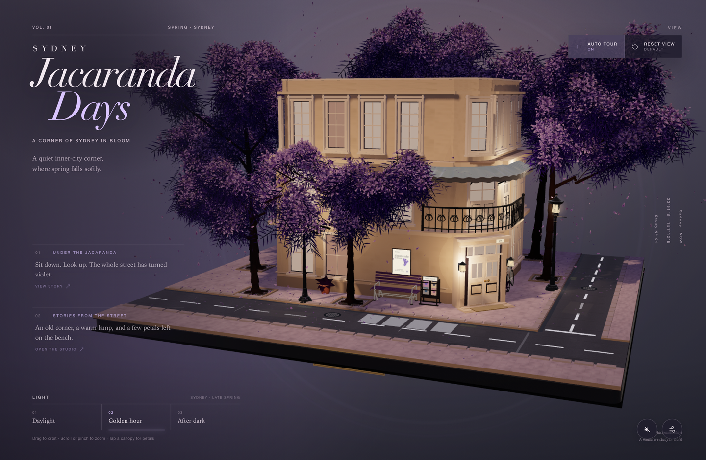
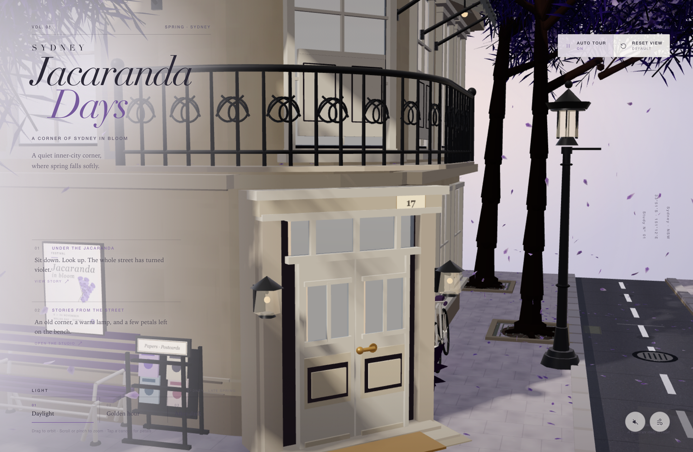

# Sydney — Jacaranda Days

A cinematic, interactive Three.js miniature of a Sydney jacaranda street corner. A cream three-storey corner house is wrapped by seven procedural jacarandas, a dark floating base, a detailed street, and a warm editorial interface. The scene supports orbit, touch, auto-tour, ambient sound, a petal breeze, and two story chapters.



## Run it

### Open the single-file build

Open [`dist/jacaranda-corner.html`](dist/jacaranda-corner.html). It contains the scene, Three.js, the UI, and all assets in one self-contained HTML file. No server is required.

### Open on a phone

The standalone build is responsive and includes a mobile layout. Serve it over your local network:

```bash
cd jacaranda-corner
./serve-mobile.command
# http://<your-lan-ip>:8080/jacaranda-corner.html
```

Or send `dist/jacaranda-corner.html` to the phone and open it in Safari / Chrome. "Add to Home Screen" gives a full-screen experience.

### Development version

Sources are ES modules and use a locally hosted Three.js build:

```bash
cd jacaranda-corner
python3 -m http.server 4173
# open http://127.0.0.1:4173/
```

### Rebuild the standalone file

```bash
cd jacaranda-corner
node scripts/build-standalone.mjs
```

The build script concatenates the modules in dependency order, embeds Three.js and the application as Blob modules, and writes `dist/jacaranda-corner.html`. The only third-party runtime dependency is Three.js r169 (MIT), stored in `vendor/three.module.min.js`.

## Interaction

- **Drag** — orbit
- **Scroll / pinch** — zoom
- **Auto tour** — slow, breathing camera drift; pauses while you interact and resumes after about 2.4 s
- **Reset view** — return to the default entrance/balcony composition
- **Click a canopy** — release a burst of petals
- **Light** — Daylight / Golden hour / After dark, with a smooth transition
- **Keyboard** — `1` / `2` / `3` change the time of day; `R` resets the camera; `Escape` closes an open story

### Story chapters

- **Under the jacaranda** — opens a framed Sydney Harbour plate: the original harbour photographs, graded to match the editorial watercolour treatment. A `Daylight / Golden hour` switch inside the story changes the plate.
- **Stories from the street** — opens *The Studio*, a warm interior scene with a story card and a return to the miniature.
- The same stories can be opened from the scene:
  - **Magazine rack** (in front of the house) → harbour story
  - **Main entrance door** → The Studio
- Story screens support **Close**, **Back to the miniature**, **Next chapter**, and **Escape**.
- **Sound** — a locally generated low-volume ambient bed with occasional soft chimes (Web Audio; no external audio assets)
- **Breeze** — sends a gust of petals through all canopies

## Composition and design

- The default screen centre is aligned with the band between the first and second floors.
- The model is framed slightly to the right of centre, with the entrance and bench as the foreground anchor.
- The planting is intentionally asymmetrical:
  - the two front trees stay low so the entrance remains readable while still standing above the street lamps;
  - the left side and the rear are layered at different depths, heights, spreads and limb counts;
  - the rear-centre crown is the tallest mass behind the roof, while the rear-left and rear-right trees sit lower and narrower to frame it.
- The backdrops and UI use an English editorial layout: Didot display type, numbered story notes, a numbered Light timeline, generous negative space, subtle grain, and a large time-of-day halo.


## Visual implementation

- **Architecture** — curved front/right corner, entrance on the corner, wrought-iron wrap-around balcony, corrugated awning, sash windows, stone sills and a pale cream wall finish.
- **Jacarandas** — seven procedural trees with different trunk lean, fork height, spread, crown density and limb count. The crowns use only violet flowers and cold blue-violet pinnate foliage; no green leaves. The entrance-side trees are deliberately kept low.
- **Street** — 1024² asphalt texture with aggregate, patch repairs, tar seams and hairline cracks; lane dashes, crossing bars, stop line, drains and gutters sit above the road surface; two manhole covers and worn edge paint complete the mini street.
- **Lighting** — three shared time-of-day presets (Day / Dusk / Night) with warm window and lamp lighting. No additional dynamic lights are created when the time changes.
- **Atmosphere** — falling petals, ground drifts beneath the trees, contact shadows, a time-aware halo, paper grain and soft vignette.
- **Lightweight geometry** — blossoms use a simplified five-lobed geometry, fronds use four pairs of leaflets, twigs and branches use low-segment cylinders, and branch joints are low-poly instanced spheres.

## Performance

The project was profiled and optimised in-browser with:

- a Playwright/WebKit frame-time harness (p50 / p95 / p99 and dropped frames);
- `renderer.info` draw-call, triangle, geometry and texture counts;
- a per-object triangle audit;
- ablation runs for petal updates, tree animation, trees, and shadows;
- a pixel-ratio sweep.

The largest original bottleneck was multi-tap PCF shadow sampling. The scene now uses a cached VSM filtered shadow map, which preserves soft shadows without per-fragment multi-tap PCF. Tree geometry was reduced, foliage is instanced, static meshes are batched, and the pixel ratio adapts to frame time.

Current benchmark on the test harness:

| Metric | Value |
|---|---:|
| Triangles | ~848k |
| Draw calls | ~174 |
| Leaf instances | ~9.6k |
| p50 frame | ~17–20 ms |
| Pixel ratio | 1.35 desktop / 1.15 coarse |

See [`PERFORMANCE.md`](PERFORMANCE.md) for the measurement notes and optimisation log.

## Project structure

```
jacaranda-corner/
├── index.html                 # development HTML + editorial UI
├── styles.css                 # layout, themes, story overlays, grain
├── src/
│   ├── main.js                # renderer, assembly, interactions, stories
│   ├── config.js              # dimensions, trees, lamps, camera
│   ├── materials.js           # procedural environment and materials
│   ├── controls.js            # orbit controls + auto drift
│   ├── architecture.js        # house, entrance, balcony, awning, windows
│   ├── streetscape.js         # base, road, kerbs, tree pits, lamps
│   ├── props.js               # bench, planters, posters, magazine rack, bicycle
│   ├── trees.js               # procedural jacarandas and lamp-local lift callers
│   ├── lamp-local-lift.js     # local branch/foliage lift around lamps
│   ├── petals.js              # fallen/falling petals and canopy bursts
│   ├── lighting.js            # Day / Dusk / Night and material transitions
│   └── utils.js               # textures, geometry helpers, static batching
├── vendor/three.module.min.js # Three.js r169
├── scripts/build-standalone.mjs
├── docs/                      # preview images
└── dist/jacaranda-corner.html # self-contained build
```

The development build exposes `window.__JACARANDA__` with `scene`, `camera`, `renderer`, `controls`, `lighting`, `trees`, `petals`, `toggleDrift()` and `stats()`.

## Preview




## Credits

- [Three.js](https://threejs.org/) r169 — MIT License, Copyright Three.js Authors. The original license header is preserved in `vendor/three.module.min.js`.
- Harbour photographs supplied as project references and embedded in the story plates.
